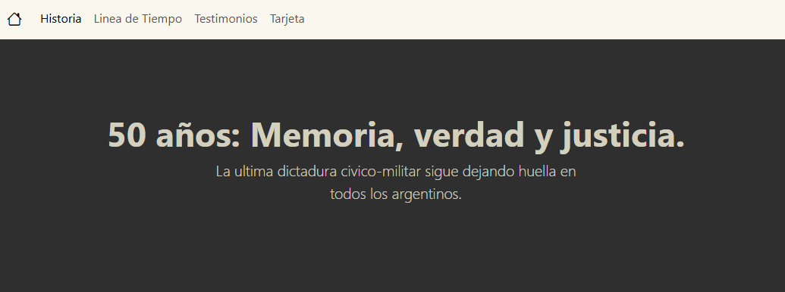
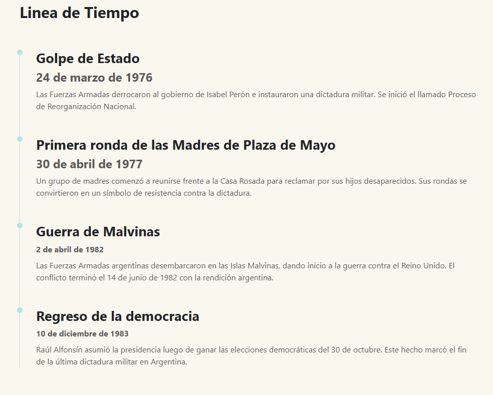
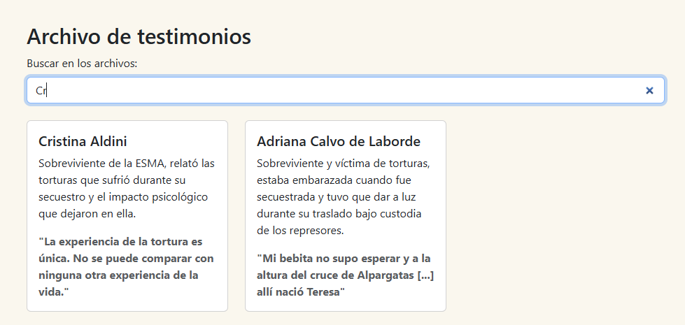
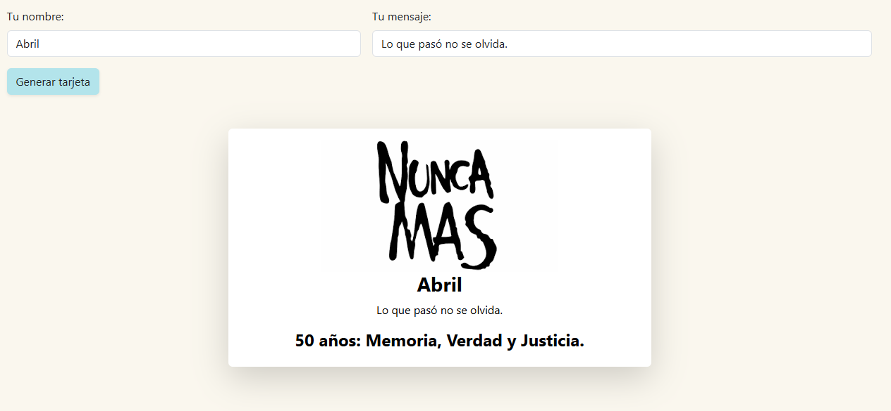
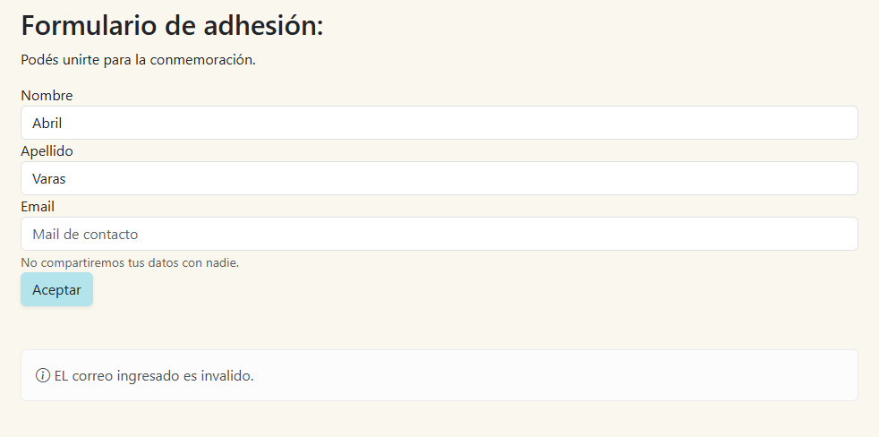

# Trabajo PRactico: 50 años - Memoria Verdad y Justicia (1976-2026)
Trabajo practico de Desarrollo Web con implementacion de HTML, CSS y JavaScript. 

# Consigna
A 50 años del golpe civico militar, se buscó emplear una clase practica con los temas de Desarrollo Web vistos en clase. Creando un landing completo desde cero.

## Requsitos:
- Header / Navbar
- Hero — "50 años. Memoria, Verdad y Justicia."

- Línea de tiempo (5-6 hitos históricos)

- Archivo de testimonios (con buscador JS)

- Generador de tarjeta conmemorativa (JS)

- Formulario de adhesión (con validación JS)

## Alumna: Abril Varas
## Universidad Nacional de Hurligham

